```text
    ___  ________  ________   ___  __          ___  ________
   |\  \|\   __  \|\   ___  \|\  \|\  \       |\  \|\   ____\
   \ \  \ \  \|\  \ \  \\ \  \ \  \/  /|_     \ \  \ \  \___|_
 __ \ \  \ \   __  \ \  \\ \  \ \   ___  \  __ \ \  \ \_____  \
|\  \\_\  \ \  \ \  \ \  \\ \  \ \  \\ \  \|\  \\_\  \|____|\  \
\ \________\ \__\ \__\ \__\\ \__\ \__\\ \__\ \________\____\_\  \
 \|________|\|__|\|__|\|__| \|__|\|__| \|__|\|________|\_________\
                                                      \|_________|
```

<p>
  
  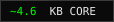
  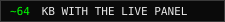
  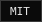
  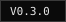
  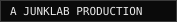
</p>

<p>
  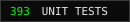
  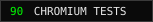
  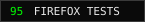
  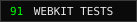
  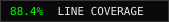
</p>

# jank.js

A performance monitor that runs inside your browser game. It shows frame pacing, the time spent in each system you name, and the slow frame with the frames around it. Record what happened, compare two versions of your workload, and read the results in a viewer that never leaves your machine.

Nothing to install beyond the package: its small UI runtime is bundled. ~4.6 KB core, ~64 KB with the panel, gzipped; the viewer loads only when you open it. Nothing is uploaded, estimated or smoothed. Missing data stays missing.

<p align="center">
  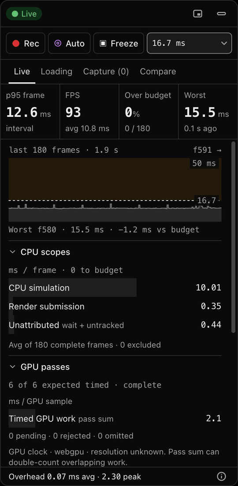
</p>

## Install

```sh
npm install jank.js
```

## Use

Call it from your own frame loop:

```js
import { createDiagnostics } from "jank.js";
import { createPerformancePanel } from "jank.js/panel";

const monitor = createDiagnostics();
const panel = createPerformancePanel({ shell: document.body, monitor });
const physics = monitor.register("physics", "Physics", () => ({
  bodies: world.bodyCount,
}));

function frame(at) {
  monitor.beginFrame(at);
  panel.refresh(at);
  const start = performance.now();
  const scope = physics.begin();
  stepPhysics(); // your update
  physics.end(scope);
  const drawn = performance.now();
  drawScene(); // your render
  monitor.endFrame(drawn - start, performance.now() - drawn);
  requestAnimationFrame(frame);
}

requestAnimationFrame(frame);
```

Mark moments with `monitor.event("Scene changed")`. Only what your app supplies is shown; sections without a source stay hidden or read as unavailable, never as zero.

## The panel

It floats in a corner of the viewport, in its own Shadow DOM, so your styles and its styles cannot touch. Three sizes, all collecting: one line for a playtest, a mini HUD, the full panel when something stutters. It's built for desktop widths.

<p>
  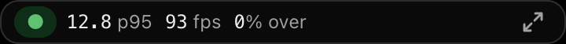
  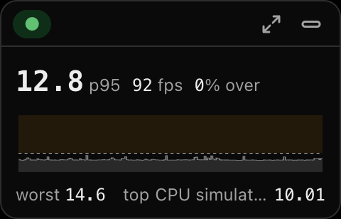
</p>

**CAPTURE** records manually, or automatically on a spike, a sustained slowdown or a whole episode, keeping the frames before and after. **LOADING** puts your load stages on one axis, with cold and repeat runs compared. **COMPARE** runs an A/B test.

<p>
  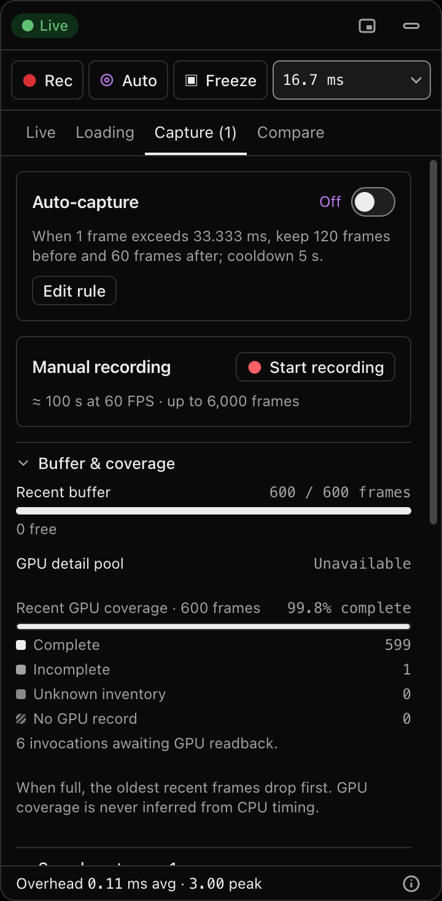
  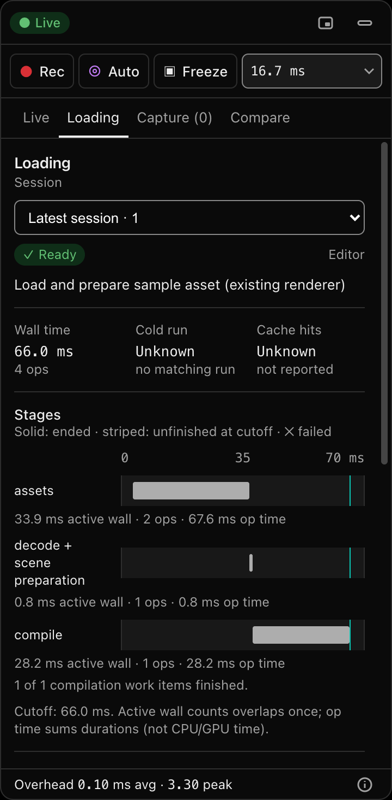
</p>

## A/B comparison

Report two variants and how to switch between them, and the panel runs them in alternating pairs with warm-up, then gives a verdict for CPU, GPU and frame time:

```js
const shadows = getShadows();
const panel = createPerformancePanel({
  shell: document.body,
  monitor,
  comparison: {
    change: "shadows",
    variants: {
      A: { label: "Shadows on", settings: { shadows: true } },
      B: { label: "Shadows off", settings: { shadows: false } },
    },
    activate: (variant) => setShadows(variant === "A"),
    restore: () => setShadows(shadows),
  },
});
```

Other settings that differ are flagged as confounds. Results are a quick estimate, not a significance test: read the size of the difference beside each verdict. Stopped and failed runs keep their finished trials.

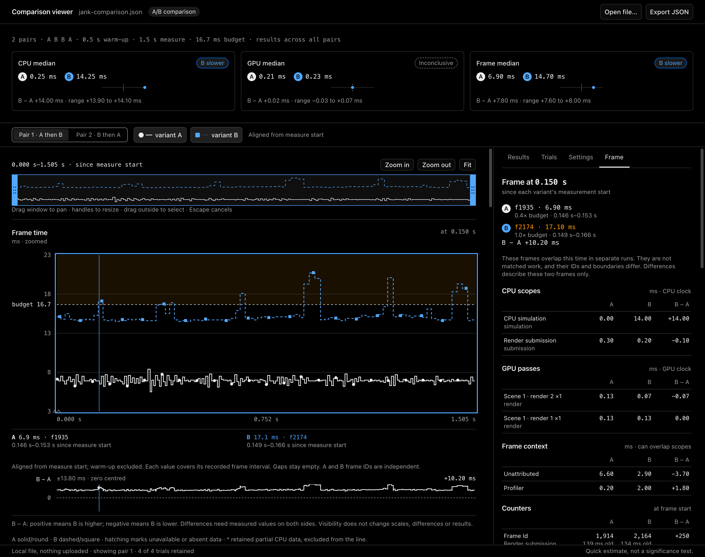

## The viewer

Open a saved capture from the panel, or use `jank.js/viewer.html`: one self-contained file. Choose a recording or comparison to step through every frame, its CPU and GPU lanes, its counters and its evidence.

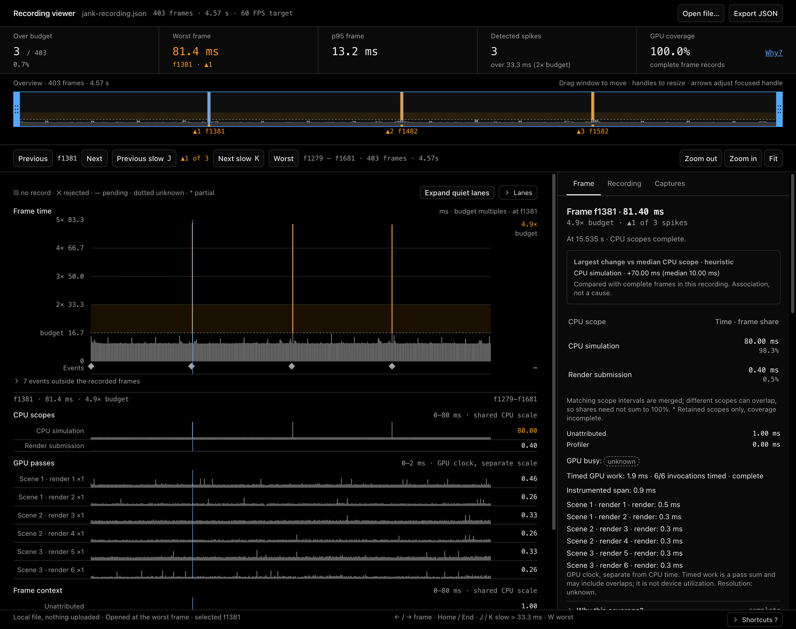

## Adapters

Optional, and none bundles a renderer. `jank.js/adapters/three` reads `renderer.info` counters. `jank.js/adapters/three-webgpu` and `jank.js/adapters/webgl2` time GPU passes: pass the source they return as `gpu`. `jank.js/adapters/three-host` adds renderer errors, instance and loading observers for Three.js hosts. `jank.js/gpu` gives frame-linked GPU evidence for recordings.

## Upgrading from 0.3

`createDiagnostics` and the rest of the core API, the recording format and existing recordings are unchanged. The panel and viewer are new:

```diff
-import { createDiagnostics, createPerformanceTray } from "jank.js";
-import "jank.js/style.css";
+import { createDiagnostics } from "jank.js";
+import { createPerformancePanel } from "jank.js/panel";

-const tray = createPerformanceTray({ shell, monitor, gpu });
+const panel = createPerformancePanel({ shell, monitor, gpu });
```

Call `panel.refresh(at)` straight after `monitor.beginFrame(at)`, and `panel.destroy()` instead of `tray.dispose()`. See [the changelog](CHANGELOG.md) for what was removed.

## Docs

[Integration](docs/integration.md) · [Data model](docs/data-model.md) · [Measurements and limits](docs/measurements.md) · [Overhead](docs/performance.md) · [GPU measurements](docs/gpu-measurements.md) · [Three.js playground](docs/three-playground.md) · [Architecture](docs/architecture.md)

See it catch something in [Junktro](https://junktro.junklab.au/), a deliberately heavy CRT desktop.

## Develop

```sh
pnpm dev            # the playground and review pages
pnpm check          # lint, types, unit tests and builds
pnpm test:package   # the packed tarball in a clean consumer
pnpm test:e2e       # the panel, viewer and built package in Chromium, Firefox and WebKit
pnpm test:e2e:gpu   # real GPU timing in Chrome on your hardware
pnpm docs:captures  # retake the README images from a real run (needs Chrome and ffmpeg)
```

Read [CONTRIBUTING.md](CONTRIBUTING.md) and [SECURITY.md](SECURITY.md).

MIT © 2026 Isaac Johnson, released by Junklab. [Third-party notices](THIRD_PARTY_NOTICES.md).
