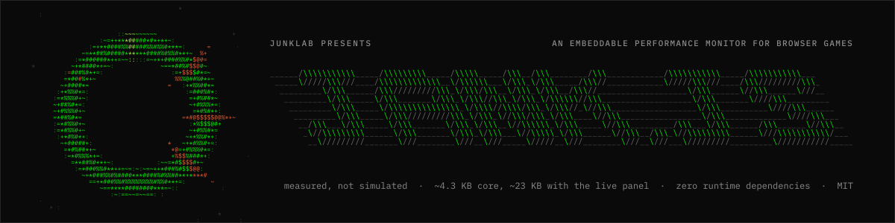
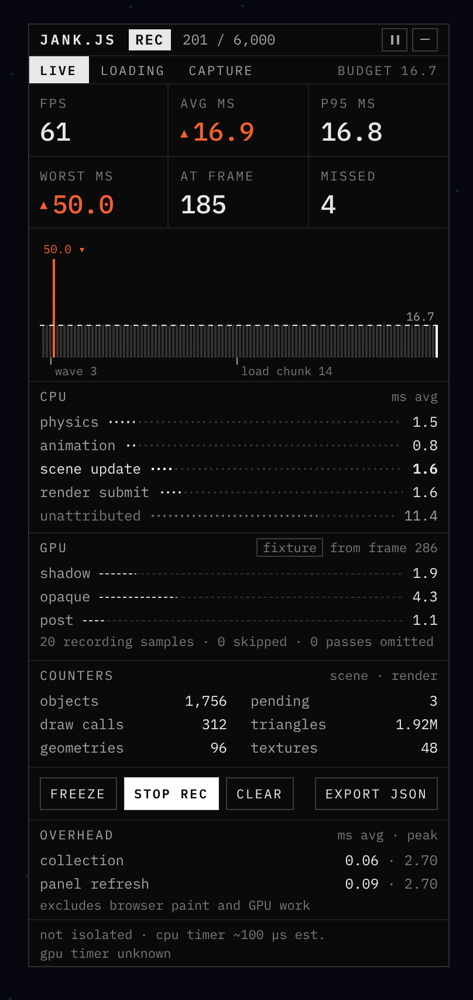

<p>
  
  
  
  
  
  
  
</p>

# jank.js

An embeddable performance monitor for browser games and interactive graphics. It runs inside your app, so the slowdown and the evidence are in the same place. Inspect frame pacing, time the systems you name, catch the slow frame with the frames around it, export the recording and open it offline.

**A ~4.3 KB core performance monitor. Zero runtime dependencies. Add the live panel for ~23 KB total.**

Gzipped production sizes after minification and tree shaking with Vite: core means `createDiagnostics`; the panel total includes CSS. No font downloads. Measured from this checkout; sizes vary with your imports and bundler.

Your app owns its frame loop. jank.js does not upload measurements, does not invent GPU timings and does not round in your favour.

**See it catch something:** [Junktro](https://junktro.junklab.au/), a deliberately heavy CRT desktop built to give jank.js something to measure.

```text
  ·:·  JANK.JS v0.1.0  ·:·  A JUNKLAB PRODUCTION  ·:·

  SUPPLIER ......... the main thread          PROTECTION ..... none (MIT)
  CRACKER .......... not required             PLATFORM ....... any browser
  SIZE ............. 0 dependencies           RUNS AT ........ whatever you give it
  KEYGEN ........... see below. there is no serial.
```

<p align="center">
  
</p>

## What you get

A panel in a corner of your game, in three sizes. One line for the whole playtest, a mini HUD for the corner of your eye, the full panel when something stutters. Every size keeps collecting.

<p>
  
  
</p>

**LIVE.** FPS, average and p95 frame time, the worst frame and which frame it was, how many missed the budget. A graph of the last 600 frames with the budget drawn as a line and your events as ticks under it. A CPU row for every system you register, with the heaviest in bold and the time nobody claimed listed as `unattributed`, because browser work and waiting are real too. GPU passes when your renderer supplies them, labelled with the frame they belong to. Counters your app reports. And at the bottom, under every tab, what the panel itself cost you, as mean and peak, collection and refresh apart.

**LOADING.** How long the app took to get ready, as stages on one axis: this session beside the first cold one, cache hits and misses, every retained session. Stages overlap, so they do not add up, and the tab says so.

**CAPTURE.** The frame budget (30, 60, 120 fps or your own), automatic capture that keeps the frames before and after a spike and then cools down, what recordings will contain, and the captures kept so far, each with its frame, its time and the nearest event.

<p>
  
  
</p>

**The viewer.** One HTML file. Open it anywhere, drop a recording on it. No app, no server, no network: `OFFLINE` in the header is a statement, not a mode. The whole session as a strip, a timeline at 4 px per frame with exact CPU lanes and dashed GPU and counter lanes, a captures table, and an inspector that shows the selected frame against the budget with a labelled `LIKELY` guess at the culprit.


## Reading the numbers

Orange means a frame missed the budget. Nothing else is orange, and an orange value always carries a ▲ as well, so the colour is never the only signal.

| Readout  | Meaning                                                                                         |
| -------- | ----------------------------------------------------------------------------------------------- |
| FPS      | Frames shown in the last second. It reads `–` until a full second has been measured.            |
| AVG MS   | Average frame interval across the retained history (the last 600 frames).                       |
| P95 MS   | 95 of every 100 frames in the history were this fast or faster.                                 |
| WORST MS | The slowest frame in the history. AT FRAME is its frame number.                                 |
| MISSED   | Frames over budget in the history: longer than the budget by more than two ticks of the timer.  |
| BUDGET   | 30, 60, 120 fps or your own target, in milliseconds per frame. Every graph and warning uses it. |

System times are inclusive, so a parent and a nested child can both report the same milliseconds. `unknown` means the measurement was not captured, not that it was zero. A truncated frame says it is truncated. The footnote under the panel states the timer's observed precision and whether the page is cross-origin isolated, because browsers coarsen clocks and the numbers are only as fine as the clock. The [user manual](docs/user-manual.md) has the rest.

## Install

```sh
npm install jank.js
```

```text
  ---[ INSTALL ]---------------------------------------------------------

  1. npm install jank.js
  2. Wrap the work you care about.
  3. Watch the panel. There is no step 4 and there is no serial.
```

jank.js is an ES module with TypeScript declarations. To try a build from this checkout instead, run `pnpm pack --pack-destination artifacts` and install the archive with `pnpm add /path/to/jank.js-0.1.0.tgz`.

## Integrate

Use a positioned container, import the stylesheet, and call `refresh` from your existing frame loop. This plain JavaScript also type-checks in TypeScript:

```js
import { createDiagnostics, createPerformanceTray } from "jank.js";
import "jank.js/style.css";

const shell = document.querySelector("#app"); // CSS: position: relative
const monitor = createDiagnostics();
const tray = createPerformanceTray({ shell, monitor });
const drawing = monitor.register("drawing", "Canvas drawing");
let animation;

function frame(at) {
  monitor.beginFrame(at);
  const updateStart = performance.now();
  updateScene(); // Your application code.
  const updateMs = performance.now() - updateStart;
  const renderStart = performance.now();
  const measured = drawing.begin();
  drawScene(); // Your application code.
  drawing.end(measured);
  monitor.endFrame(updateMs, performance.now() - renderStart);
  tray.refresh(at);
  animation = requestAnimationFrame(frame);
}
animation = requestAnimationFrame(frame);

addEventListener(
  "pagehide",
  () => {
    cancelAnimationFrame(animation);
    tray.dispose();
    drawing.dispose();
    monitor.dispose();
  },
  { once: true },
);
```

The next frame boundary seals the preceding interval. Name the work, count the things, mark the moments:

```js
const physics = monitor.register("physics", "Physics", () => ({
  bodies: world.bodyCount, // shown under COUNTERS
}));
const start = physics.begin();
stepPhysics();
physics.end(start);
monitor.event("Scene changed", "Loading arena");
monitor.setTargetFps(120); // the budget every readout uses
monitor.armCapture(); // keep the frames around the next spike
```

Options on `createPerformanceTray`: `mode` (`"line"`, `"mini"` or `"full"`), `corner`, `viewerUrl` so OPEN IN VIEWER has somewhere to go, `capture` for the automatic window, and optional sources for GPU timings, visibility, temporal history and loading stages. Omit a source and its section stays hidden. Nothing is instrumented automatically; a number appears because your app supplied it.

Adapters are optional and import no renderer. `jank.js/adapters/three` reads a structural subset of `renderer.info` for draw calls, triangles, geometries and textures. `jank.js/adapters/three-webgpu` reports the sum of render-pass durations from Three r186's timestamp queries, when the device exposes them, and says `unsupported` when it does not, rather than guessing from CPU time. `jank.js/adapters/webgl2` times named render passes with WebGL2 timer queries where the browser exposes them, and says `unsupported` elsewhere for the same reason. Turn on DevTools tracks and your named scopes appear in Chrome's Performance panel through the User Timing API, no extension required.

Read the [integration and adapter contracts](docs/integration.md), the [data model and custom views](docs/data-model.md), the [measurement definitions and limits](docs/measurements.md) and the [measured overhead](docs/performance.md).

## The recording viewer

The package exports `jank.js/viewer.html`, a self-contained offline viewer. Copy it to your static host and pass its URL as the panel's `viewerUrl` option; the panel hands recordings to it in a new window and nothing leaves the browser. From a checkout, run `pnpm install --frozen-lockfile` and `pnpm build`, then open **OPEN RECORDING VIEWER.html**, or run `pnpm dev` to open the viewer.

Recordings are versioned JSON with the environment written in: versions, browser, platform, viewport, pixel ratio, isolation, timer precision and what was instrumented. `parseRecording` validates untrusted files strictly, migrates the old format 1 without inventing metadata, and refuses anything over 32 MiB without touching what is already open.

## House rules

```text
  ---[ RELEASE NOTES ]---------------------------------------------------

  Nothing in the panel is simulated. The graph is your frames. Orange is a
  frame the display skipped. The keygen jokes are jokes; the numbers are not.

  * A profiler should show its own cost. OVERHEAD does, under every tab.
  * It should say what it cannot see. unknown means unknown, truncated
    means truncated, and GPU time is never inferred from CPU time.
  * It should stay out of the way. The panel is a guest: fixed in a corner,
    no second animation loop, no captured keyboard shortcuts unless focused,
    nothing prevented on your events.
  * It should be honest about clocks. Browsers coarsen timers; the panel
    states the precision it observed and judges a miss by the budget plus
    two ticks of it, nothing finer.
```

Measured on 27 October 2026 on an Apple M3 Max in headless Chromium, the one-line panel cost a mean 0.06 ms per frame, the full panel 0.13 ms, and the full panel while recording 0.13 ms, timer and loop overhead included. That is one machine and one fixture; [the report](docs/performance.md) states the limits, and `pnpm bench` measures yours.

## Development

pnpm 11.24.0, Node 22.12+, strict TypeScript, Vite, Vitest, Playwright, oxlint and oxfmt. No framework, no state library, no engine package. Three.js is used only by projection tests; it and the browser-testing packages are development dependencies.

```sh
pnpm check                              # Format, lint, unit tests, types and builds
pnpm test:package                       # Install the tarball in an isolated consumer
pnpm exec playwright install chromium firefox webkit
pnpm test:e2e                           # Test the packaged panel and viewer (run pnpm build first)
pnpm check:full                         # All of the above
pnpm bench                              # Local overhead report in artifacts/overhead.json
pnpm docs:images                        # Refresh the user manual's screenshots (Chromium)
```

The browser suite covers the pinned Chromium, Firefox and WebKit engines on macOS. Older browsers and mobile devices are not yet certified; see [browser support](docs/measurements.md#browser-support). CI runs the checks and package verification on Ubuntu and Windows, and the browser suite on macOS. The screenshots above were taken by the suite on its own fixture game, whose CPU work is real and whose GPU source is scripted and labels itself `fixture` so no reader mistakes it.

## Contribute and release

Read [CONTRIBUTING.md](CONTRIBUTING.md), the [release guide](docs/releasing.md), the [code of conduct](CODE_OF_CONDUCT.md), and report vulnerabilities as described in [SECURITY.md](SECURITY.md). The API is an initial 0.x API; changes to public types and the recording format go in [CHANGELOG.md](CHANGELOG.md).

```text
  ---[ GREETS ]----------------------------------------------------------

  CiM · keygenjukebox · mrdoob · pmndrs · three.js · the demoscene

  vsync_dan · sixteen.seven · jank_lord · GC_PAUSE · TRIPLE_BUFFER ·
  deadline_miss · the_main_thread (who never calls back) · everyone
  shipping games in a browser

  ---[ CREDITS ]---------------------------------------------------------

  GROUP ............ Junklab, Australia
  CODE ............. Isaac Johnson (zackabrah)
  DESIGN ........... Isaac Johnson
  LICENCE .......... MIT · (C) 2026 Isaac Johnson · released by Junklab

  ·:·  EOF  ·:·
```

MIT licensed, copyright Isaac Johnson. Extracted from Junklab Engine 0.94.1 (d6f5036), with independent packaging and a generic API. [Third-party notices](THIRD_PARTY_NOTICES.md) cover derived styling and historical dependencies. The panel and viewer use system monospace fonts.

Made by [Isaac Johnson](https://github.com/zackabrah) at Junklab, Australia.
