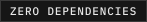
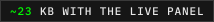
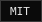
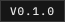
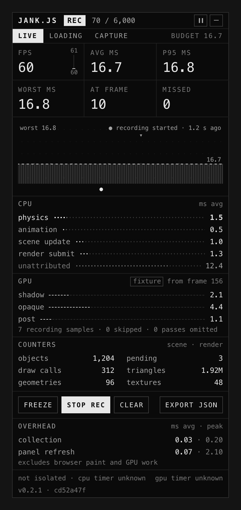
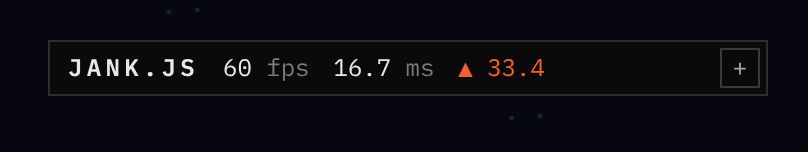
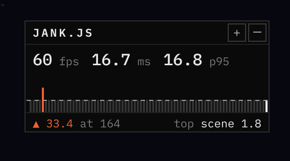
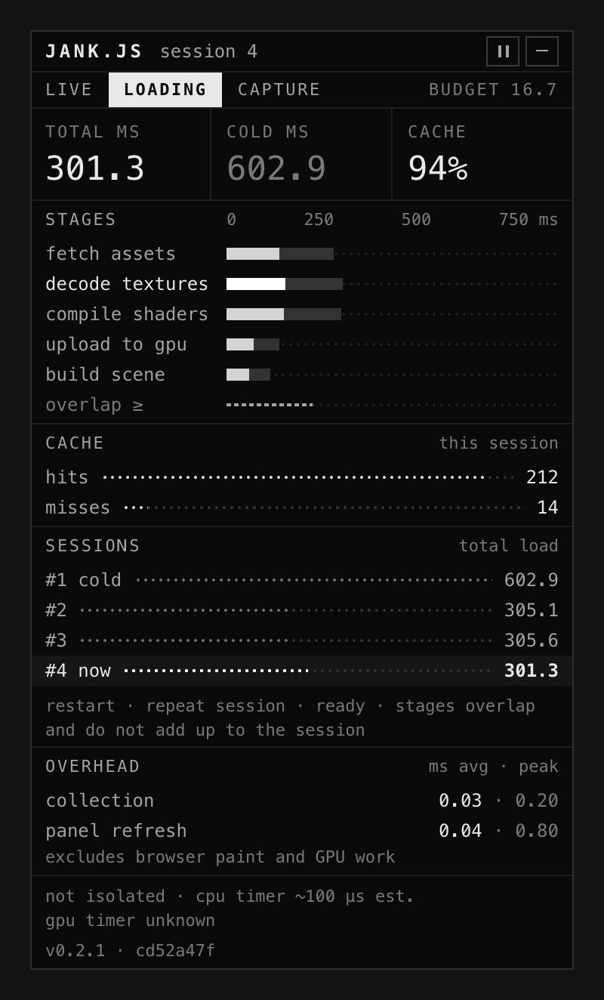
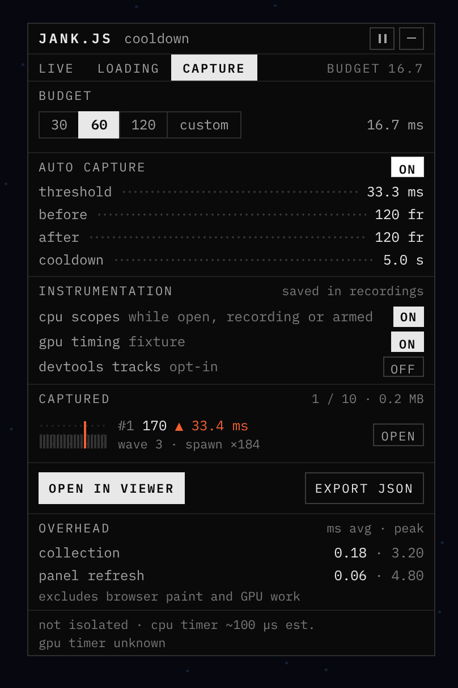
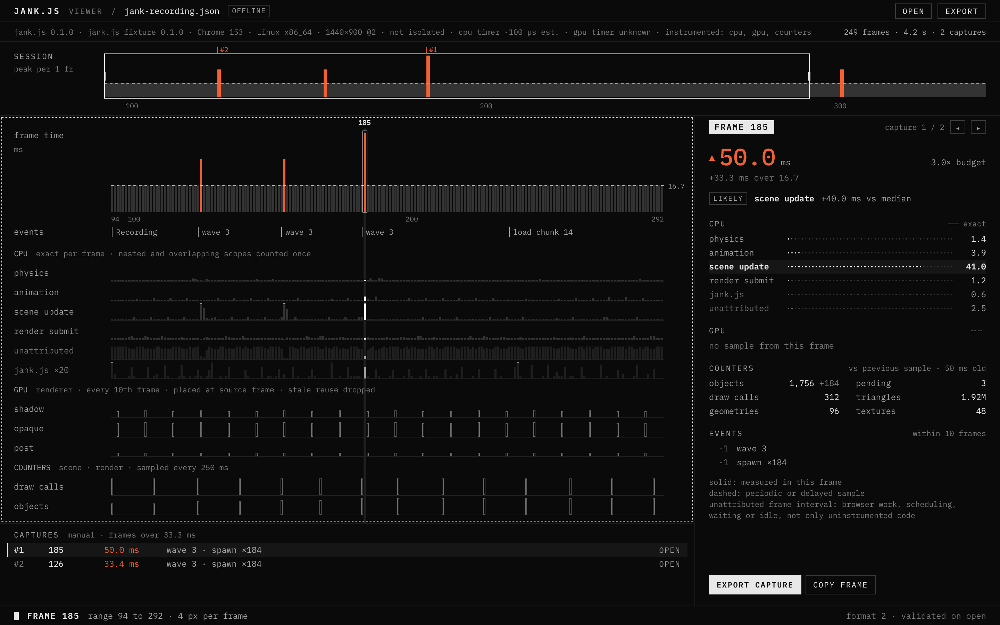

```text
    ___  ________  ________   ___  __          ___  ________
   |\  \|\   __  \|\   ___  \|\  \|\  \       |\  \|\   ____\
   \ \  \ \  \|\  \ \  \\ \  \ \  \/  /|_     \ \  \ \  \___|_
 __ \ \  \ \   __  \ \  \\ \  \ \   ___  \  __ \ \  \ \_____  \
|\  \\_\  \ \  \ \  \ \  \\ \  \ \  \\ \  \|\  \\_\  \|____|\  \
\ \________\ \__\ \__\ \__\\ \__\ \__\\ \__\ \________\____\_\  \
 \|________|\|__|\|__|\|__| \|__|\|__| \|__|\|________|\_________\
                                                      \|_________|

  ·:·  JANK.JS  ·:·  A JUNKLAB PRODUCTION  ·:·  every frame leaves a trace  ·:·
```

<p>
  
  
  
  
  
  
  
</p>

# jank.js

A performance monitor that runs inside your browser game. It shows frame pacing, the time spent in each system you name, and the slow frame with the frames around it, then exports a recording you can open offline.

Zero runtime dependencies. ~4.3 KB core, ~23 KB with the panel, gzipped. Nothing is uploaded, estimated or smoothed.

<p align="center">
  
</p>

## Install

```sh
npm install jank.js
```

## Use

Call it from your own frame loop:

```js
import { createDiagnostics, createPerformanceTray } from "jank.js";
import "jank.js/style.css";

const monitor = createDiagnostics();
const tray = createPerformanceTray({
  shell: document.querySelector("#app"), // a positioned element
  monitor,
});
const physics = monitor.register("physics", "Physics", () => ({
  bodies: world.bodyCount,
}));

function frame(at) {
  monitor.beginFrame(at);
  const start = performance.now();
  const scope = physics.begin();
  stepPhysics(); // your update
  physics.end(scope);
  const drawn = performance.now();
  drawScene(); // your render
  monitor.endFrame(drawn - start, performance.now() - drawn);
  tray.refresh(at);
  requestAnimationFrame(frame);
}

requestAnimationFrame(frame);
```

Mark moments with `monitor.event("Scene changed")`. Only what your app supplies is shown; sections without a source stay hidden.

## The panel

<p align="center">
  
</p>

Three sizes, all collecting: one line for a playtest, a mini HUD, the full panel when something stutters.

<p>
  
  
</p>

**LOADING** puts load stages on one axis, this session against the cold start. **CAPTURE** keeps the frames before and after each spike.

<p>
  
  
</p>

## The viewer

`jank.js/viewer.html` is one self-contained file. Drop a recording on it to step through every frame, its CPU and GPU lanes, and a labelled guess at the culprit. No server, no network.



## Adapters

Optional, and none imports a renderer. `jank.js/adapters/three` reads `renderer.info` counters. `jank.js/adapters/three-webgpu` and `jank.js/adapters/webgl2` time render passes with GPU timer queries, and report `unsupported` where the browser has none, rather than guessing from CPU time.

## Docs

[User manual](docs/user-manual.md) · [Integration](docs/integration.md) · [Data model](docs/data-model.md) · [Measurements and limits](docs/measurements.md) · [Overhead](docs/performance.md) · [Changelog](CHANGELOG.md)

See it catch something in [Junktro](https://junktro.junklab.au/), a deliberately heavy CRT desktop.

## Develop

```sh
pnpm check          # format, lint, unit tests, types and builds
pnpm test:e2e       # the packaged panel and viewer in Chromium, Firefox and WebKit
pnpm bench          # overhead on your machine
pnpm docs:captures  # retake the README images and social card (needs ffmpeg)
```

Read [CONTRIBUTING.md](CONTRIBUTING.md) and [SECURITY.md](SECURITY.md).

MIT © 2026 Isaac Johnson, released by Junklab. [Third-party notices](THIRD_PARTY_NOTICES.md).
