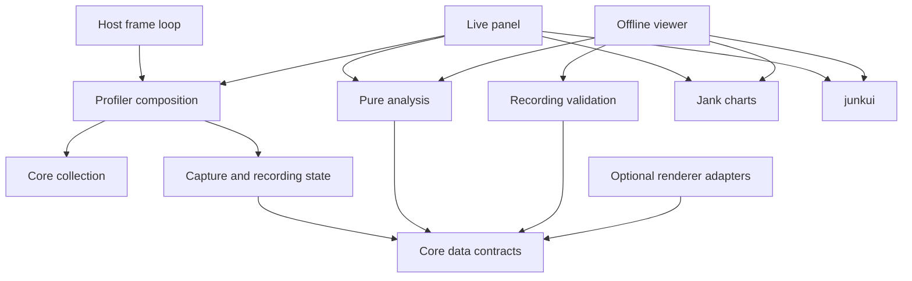

# Architecture proposal

Status: architecture and contracts established; collection, capture, validated files and public
profiler composition are implemented. See [collection behavior](collection.md) and
[recording behavior](recordings.md) for verified semantics. The independent junkui theme,
native controls and tabs are also implemented; panel/viewer, analysis, loading and adapters
remain pending.

## Decisions already made

The rewrite may change the public API and recording format. The package remains `jank.js`.
Preserve the current live panel and offline viewer's features and appearance. Extract the
general UI and theme into an independent `junkui` workspace package. Keep zero shipped runtime
dependencies, optional renderer adapters, local-only measurements, and the host-owned frame loop.

Names and interfaces below are proposals made concrete as TypeScript contracts. They should be
tested against representative integrations before they become stable. There are no published
compatibility promises on this branch.

## Problems to remove

The reference has roughly 1,048 lines in `core/diagnostics.ts`, 2,696 in `performance/tray.ts`,
and 1,448 in `viewer/entry.ts`. Length is evidence to inspect responsibilities, not itself a
reason to split. The collector currently imports defaults and vocabulary from the recording
parser. The panel owns capture history as well as presentation. Provider types, copying,
formatting, interaction and rendering are concentrated in the panel module. Theme and general
controls sit inside the profiler's source tree.

The rewrite should make a normal change local: adding a counter must not require learning
capture state transitions; changing keyboard behavior must not require reading collection
code; changing a theme color must not involve a profiler package.

## Two packages, not a package for every folder

| Owner     | Owns                                                                                                                                   | Must not own                                                                            |
| --------- | -------------------------------------------------------------------------------------------------------------------------------------- | --------------------------------------------------------------------------------------- |
| `junkui`  | Semantic CSS tokens, scoped native-control styles, focus/disabled states, tabs and small interaction helpers, component gallery        | Timing, profiler models, recordings, renderer adapters, application persistence, charts |
| `jank.js` | Measurements, bounded histories, recording validation, analysis, panel/viewer behavior, profiler charts, optional sources and adapters | A general-purpose UI framework, a renderer, a scheduler for the host, network transport |

`jank.js` consumes only documented `junkui` exports. `junkui` never imports `jank.js`, even for
types. Do not introduce a third shared-types package for trivial shapes such as `dispose()`.

The eventual build bundles the selected junkui CSS and helpers into jank's existing CSS and
viewer assets. It records junkui as a workspace build dependency, not an installed runtime
requirement. This keeps the current zero-runtime-dependency distribution. Independently
publishable builds, export checks and license notices are required before either package ships.

## Source organization

The contracts already use these ownership boundaries. Implementation files are added when a
slice needs them; this tree is not a request to generate dozens of empty modules.

```text
packages/
  jank/
    src/
      core/          frame/scopes/counters, bounded storage, clock invariants
      recordings/    capture state, bounded archive, schema and file validation
      analysis/      pure statistics, interval union, frame inspection
      loading/       run ownership and elapsed-stage measurements
      adapters/      optional WebGL2, pinned Three WebGPU, User Timing
      panel/         live view state, tabs, view models and rendering
      viewer/        offline view state, navigation, inspection and file UI
      charts/        jank-specific canvas drawing and geometry
      browser/       downloads, storage, viewer handoff, environment collection
      sources.ts     optional host-source contracts, independent of panel rendering
      profiler.ts    narrow composition point and public monitor contract
      index.ts       deliberate package export surface
  junkui/
    src/
      theme/         CSS token definitions; the single theme source of truth
      controls/      native button/input/tab/focus styling
      tabs.ts        only reusable tab keyboard behavior
      index.ts       deliberate package export surface
    gallery/         native controls with actual labels and keyboard behavior
tests/
  contracts/         type-checked consumer examples and negative cases
  tooling/           executable checks of lint and package boundaries
```

Keep unit tests beside the module they exercise. Browser fixtures live with their owning
package. Do not build barrels at every directory level. Internal imports name the owning
module; package consumers use public exports. No cross-package relative source imports.

## Dependency direction



The core collector has no knowledge of DOM, files, storage, UI modes, renderer internals or
recording JSON. Capture consumes sealed frame observations and core data. The public facade
composes those owners through direct calls. Analysis does not reach back into live mutable
state. File validation never mounts a UI. Charts receive prepared numeric data and a resolved
palette; they do not fetch snapshots, parse recordings or decide what a slow frame means.

Core, recordings, analysis, loading and the profiler contract compile without browser or Node
ambient types. Browser environment defaults are resolved at the integration boundary. Biome
rejects imports from those layers into UI/adapters and imports from junkui into jank.

## Types describe facts, not implementation machinery

Keep shared measurement data separate from mutable internal state and view models. Public
snapshots and saved recordings are detached and readonly. Runtime owners may mutate their own
bounded buffers; readonly is not a deep-freeze guarantee and does not replace boundary copies.

- Use `startedAtMs`, `durationMs`, `widthPx`, `frameId` and `rendererFrameId` where units or
  domains matter. Do not use `n`, `x`, `at`, `ms` or `data` for a long-lived domain concept.
- Use a discriminated union when fields depend on a status. `GpuState` cannot be both disabled
  and ready; capture state is not a collection of independent flags. Counter samples contain
  either validated values or a provider error, never an invented zero after failure.
- Use `null` for a known absence in a snapshot, optional fields for configuration defaults,
  and an empty array for a known empty collection. Unknown GPU time is never zero.
- Store observed facts once. Derive interval duration from frame boundaries, frame budget from
  target FPS, and sample age from explicitly correlated frame IDs.
- Use ordinary named interfaces and small unions. The only nominal handle proposed so far is
  a numeric scope token, because passing a timestamp as a token is a concrete integration risk.
  No branded-unit framework, deep mapped-type API or generic entity model is needed.
- Model loading work with a run handle and an operation handle. A late asynchronous completion
  retains its original owner instead of consulting whichever run happens to be current.

Only fields required by an existing feature belong in the first schema. New abstractions must
be justified with a real caller and test. The current contract files are examples of these
boundaries, not a declaration that every future module needs a public interface.

## State ownership and lifecycle

| State or resource                                         | Owner                | Lifetime / cleanup                                                       |
| --------------------------------------------------------- | -------------------- | ------------------------------------------------------------------------ |
| Clock origin, frame IDs, open scopes, recent history      | Profiler             | One profiler; frame IDs never repeat after clear                         |
| Manual/automatic capture and completed archive            | Capture controller   | Profiler lifetime; survives closing the panel                            |
| Counter providers, event/GPU history, latest observations | Observation history  | Profiler lifetime; snapshots and recording selections copy nested values |
| Loading operation                                         | Its loading run      | Sealed by finish/replacement; late completion cannot enter another run   |
| GPU queries and asynchronous readback                     | Specific adapter     | Adapter disposal releases only its own queries and settings              |
| Host renderer, host frame loop, injected trace sink       | Host                 | Never disposed by panel or profiler                                      |
| Expanded-mode demand for scopes                           | Individual panel     | Acquires/releases its own request; cannot disable another caller         |
| Frozen display and selected tab                           | Panel                | Frozen snapshot is presentation state; collection continues              |
| Imported recording and selected frame/range               | Viewer               | Failed import leaves current valid recording and selection intact        |
| DOM listeners, observers and canvas surfaces              | Mounted view/control | Removed on dispose; repeated dispose is harmless                         |
| User preferences                                          | Browser integration  | Small validated values; storage failure must not stop profiling          |

`clear()` invalidates open scopes and pending capture state atomically. Late GPU samples whose
frame IDs no longer exist stay unlinked or are dropped according to the adapter's documented
policy; they are never attached to a reused ID. Disposal is idempotent. Calls such as late
panel refresh become no-ops after disposal; invalid configuration and programming mistakes
throw descriptive errors before mutating state.

Host counter callbacks can remove channels, clear or dispose the profiler. Polling checks
provider identity and a lifecycle generation before retaining results. A disposed channel
handle cannot remove a replacement provider. Callback failures become explicit counter errors;
trace failures release only the trace request and produce a diagnostic event.

## Timing and data flow

The host calls `beginFrame(timestamp)` at a real frame boundary. That seals the previous frame
and opens the next. `endFrame` optionally supplies host CPU totals but does not fabricate an
ending boundary. The last open frame is excluded until the next boundary. Every supplied
timestamp shares the profiler's monotonic clock. Exported times use milliseconds from the
profiler's origin, including captures taken later in the session.

Validate frame boundaries and scope-clock readings as separate monotonic sequences: browser
timer rounding can put a scope clock slightly behind the animation timestamp. Clip intervals
at sealing instead of treating that difference as clock regression. Equal frame timestamps
accumulate CPU totals into the same pending frame. Initial boundaries predating creation are
skipped. Scope-demand changes take effect at the next distinct frame boundary.

```text
host boundary → seal previous frame → update bounded history → advance capture state
host work     → channel begin/end   → collect bounded scope intervals
host refresh  → read snapshot       → derive view model → write changed DOM / draw canvas
file import   → parse unknown input → validate schema   → replace viewer state on success
```

CPU scopes may overlap; total attributed time uses their interval union. Per-system timings
remain inclusive. GPU results arrive asynchronously and need an explicit diagnostics frame
ID. A Three render-pass sum and a WebGL elapsed span carry different measurement labels.
Loading measurements include waiting and overlap; they are not GPU or CPU execution time.
Tool overhead covers synchronous collection and refresh, excluding deferred layout/paint/GPU.

## Capture transitions

| Current state | Event                          | Result                                            |
| ------------- | ------------------------------ | ------------------------------------------------- |
| Idle          | Start manual recording         | Manual capture                                    |
| Idle          | Arm automatic capture          | Armed with validated options                      |
| Armed         | Sealed frame exceeds threshold | Collect the configured after-frame window         |
| Collecting    | Window complete                | Archive detached capture; cooldown if still armed |
| Collecting    | Disarm                         | Finish this window, then idle                     |
| Cooldown      | Cooldown elapsed               | Armed                                             |
| Manual        | Stop or capacity reached       | Archive detached recording; idle                  |
| Any           | Clear / dispose                | Invalidate active work and release owned storage  |

Starting manual recording while automatic capture is armed disarms it. If an automatic window
is already collecting, seal it as truncated before starting manual capture. Repeated start
during manual capture is a no-op; stop while not manual returns null. Re-arming while a window
is collecting applies new settings to the next window, not the one already being captured.
These policies must receive transition tests before implementation is accepted.

## UI and theme boundary

Keep the current dark, flat monospace appearance, dimensions, colors and interaction. Extract
the general foundation, not profiler semantics. `junkui` owns neutral surfaces, text, borders,
focus, typography, spacing, control sizing, and accessible native-control states. `jank.js`
maps its semantic roles such as missed-frame warning, lane color and panel width onto those
tokens. Orange meaning "over budget" belongs to jank, not to a universal junkui severity model.

CSS custom properties are the canonical theme API. Do not mirror every CSS token in a mutable
JavaScript theme store. Canvas charts resolve only the palette they need at mount and on an
explicit theme refresh. Keep selectors scoped; a reusable reset must not remove native focus,
button alignment or disclosure semantics. A `.jl` namespace reduces collisions but is not
perfect isolation from arbitrary host CSS; test hostile host styles rather than claim it is.

Prefer semantic HTML and native inputs. Share keyboard/focus behavior only where it is more
than a styled element. Tabs are the first such control. Do not introduce virtual DOM,
inheritance-based components, a widget registry, declarative JSON layouts or generic forms.

## Deduplication and decoupling

Share one implementation of interval union, timer-aware budget comparison, formatting of
measurement units, recording validation, and jank graph geometry where the semantics match.
Keep the live panel's refresh policy separate from offline navigation, despite similar DOM.
Keep adapter-specific GPU lifetime rules separate even when their readout types match.

Extract a function when its name and inputs let a reader understand it without studying the
caller. Avoid helpers that merely rename an expression or forward all arguments. A little
repeated markup is preferable to one universal renderer with modes and escape hatches.
Dependencies are explicit imports, arguments, or owned state. No ambient mutable registries,
cross-module singleton caches, generic service locator or internal event bus is planned.

## Errors, validation, and security

Imported JSON is `unknown` until checked for version, shape, finite/ranged numbers, capacities,
monotonic frame ordering, scope boundaries and references. Apply the encoded-byte limit before
deep parsing. Invalid imports return a typed problem with a field path. Caller misuse of the
export API throws; a failed export retains the captured data. Version 1/2 compatibility is not
part of the new runtime; old files are rejected clearly or handled by a later separate converter.

Host labels and file text enter DOM through text nodes. Viewer handoff checks source window,
expected origin and message shape. File URLs use local import; no wildcard remote messaging.
Storage/download/clipboard failures are reported in the relevant UI without losing data.
Provider read failures produce an unavailable/error state, not invented zeros. Do not silently
catch every exception; contract violations and optional environment failures are different.

## Performance without speculative machinery

Retain bounded histories and cap scopes, samples, events and files. Allocate and clone at
snapshot/export boundaries, not automatically for every consumer on every host frame. Use a
ring buffer where bounded rolling history calls for one. Pool or cache other objects only
after measuring a specific allocation or recomputation problem. No workers, WASM or ECS.

Preserve the current 600-frame recent history, 6,000-frame manual cap, ten saved captures,
128 default scopes per frame and 32 MiB file limit unless a tested change is approved. Check
the reference limits before implementing optional sources. Benchmark equivalent workloads and
report device/browser, sample count and noise; fewer lines is not evidence of faster code.

## Review standard

A reviewer should be able to follow frame collection, a capture, a panel interaction and a
file import from entry to cleanup without reading unrelated domains. Types should make legal
states visible. Tests should explain observable behavior. Module boundaries must reduce the
knowledge a caller needs, not merely satisfy a line limit. See the separate quality policy
and feature plan for enforceable gates and the implementation sequence.
