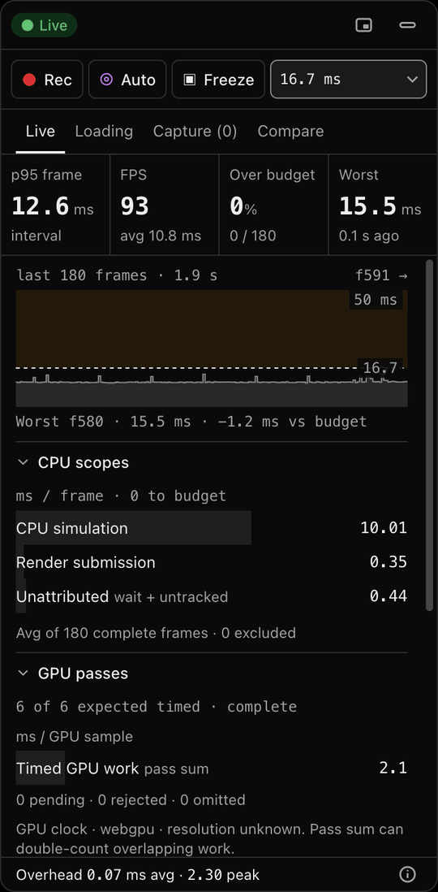
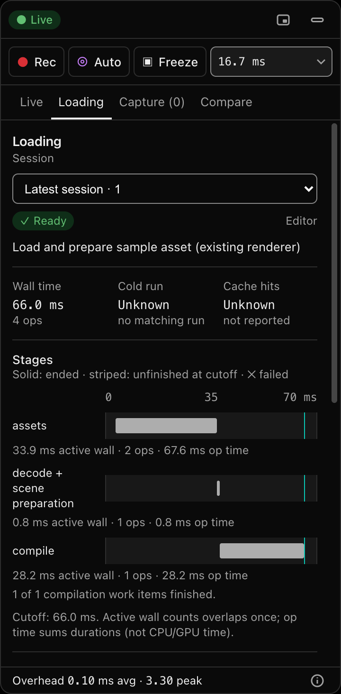
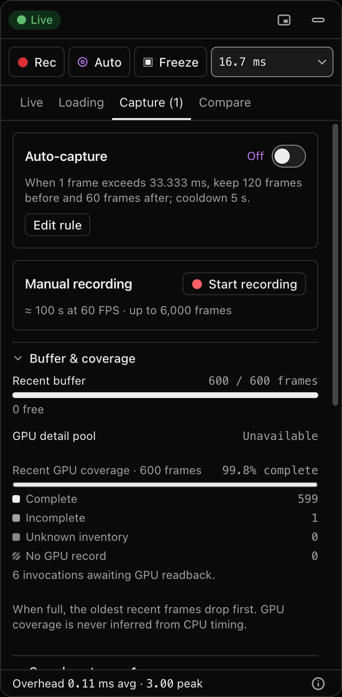
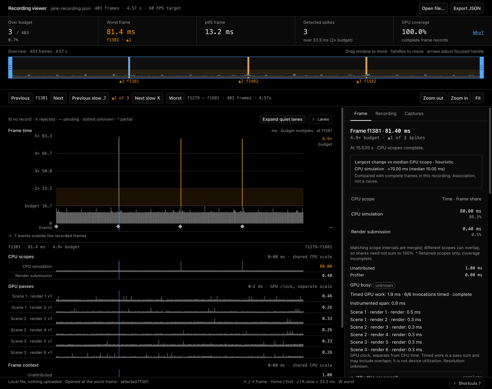
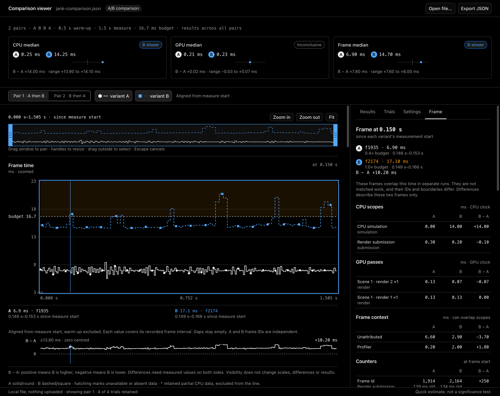

# jank.js user manual

jank.js shows why a browser game or interactive graphic stutters, from inside the running application. Record the slow moment, read it frame by frame, compare two settings and hand someone the file. Measurements stay on your machine.

This manual is for whoever is looking at the panel. To add jank.js to your own application, see the [integration guide](integration.md).

## 1. Quick start

1. Open an application that integrates jank.js. The panel floats in a corner of the page, top right unless the application chose another.
2. Leave the workload alone for a few seconds to see its normal frame pattern.
3. Press **Rec**, then reproduce the slow operation. The panel moves to its **Capture** tab and shows how much room is left.
4. Let a few more frames run, then press **Stop and save**.
5. Press **Open** on the green notice, or on the capture's row once the notice has gone. The recording opens in the viewer at its worst frame.
6. To keep it, press **Export JSON** in the viewer. Captures live in memory and are gone when the page reloads.

## 2. The panel

The panel has three views. Collection and recording carry on in all of them.

| View | What it shows                                                                                   |
| ---- | ----------------------------------------------------------------------------------------------- |
| Full | Every readout, the controls and the tabs. The panel opens this way.                             |
| Mini | p95, FPS and share over budget, the frame graph, the worst frame and the top CPU scope.         |
| Line | One row: p95, FPS and share over budget. The share gives way when another state needs the room. |

The icons in the header switch views. Badges beside them show what is running: **Live**, **Frozen**, **Rec**, **Armed**, **Capturing**, **Cooldown**, **A/B** and **Loading**.

The controls sit under the header in the full view:

| Control | Key | What it does                                                                                                                                                                                 |
| ------- | --- | -------------------------------------------------------------------------------------------------------------------------------------------------------------------------------------------- |
| Rec     | R   | Starts a manual recording and opens the full panel on **Capture**. Pressed again, it stops and saves.                                                                                        |
| Auto    | A   | Arms automatic capture with the current rule.                                                                                                                                                |
| Freeze  | F   | Holds the display so you can read it. The application, collection and any recording carry on. **Resume**, or **Freeze** again, returns to live numbers.                                                            |
| Budget  |     | The frame time to judge against: 33.3 ms (30 FPS), 16.7 ms (60 FPS), 8.3 ms (120 FPS) or a custom 1 to 1000 ms. It does not change the application's frame rate. Locked during a comparison. |
| Views   | M   | Cycles Full, Mini and Line.                                                                                                                                                                  |

Keys work while focus is inside the panel, and not while you are typing in a field.

The tabs are **Live**, **Capture**, and, when the application supplies them, **Loading** and **Compare**. Move between tabs with the arrow keys. The **Overhead** line stays at the bottom of every tab.

## 3. Reading the Live tab

Orange marks time over budget.

| Tile        | Meaning                                                                   |
| ----------- | ------------------------------------------------------------------------- |
| p95 frame   | 95 of every 100 recent frames were this fast or faster.                   |
| FPS         | Frames finished in the last second, with the average frame time under it. |
| Over budget | The share of recent frames over budget, and the count under it.           |
| Worst       | The slowest recent frame, how long ago it ran and its frame number.       |

"Recent" means the last 180 frames, which are the frames in the graph: about 3 seconds at 60 FPS.

A frame counts as over budget when it is longer than the budget by more than two ticks of the browser's timer. Both ends of a frame interval are timer readings, so a smaller difference cannot be measured. With a 0.1 ms timer and a 16.667 ms budget, the limit is 16.867 ms.

GPU timing allows one exception. When the busier of median CPU and GPU work uses under 80% of both the typical frame time and the budget, the display set the pace, so a frame counts only above the larger of the typical frame time and the budget, plus 5% or 1 ms. On a 57 Hz display with a typical 17.5 ms frame, the limit is 18.5 ms. The graph, the tiles, the viewer and `recordingSummary` all use these rules. The **ⓘ** button in the footer states the allowance for your browser.

The graph runs oldest to newest, left to right, and its caption says how many frames and seconds it covers. The dashed line is the budget, and only the part of a bar above the budget is orange. The line under the graph names the worst frame and its distance from the budget. Ticks mark events from your application, and a shaded band marks frames going into the current recording or capture.

**CPU scopes** lists the average milliseconds per frame of each scope the application times, with bars from zero to the budget. Scopes can nest and overlap; each row counts its own time once, so the rows need not add up. **Unattributed** is frame time outside every scope: waiting, browser work and code nobody has wrapped yet. The line beneath says how many frames contributed, because only frames with complete scope records count. A scope shorter than one timer tick counts as 0 ms for that frame.

**GPU passes** needs a timing source from the application, and reads **unknown** without one. With one, it reports how many expected passes were timed, the sum of their times, each pass, and the span from first to last. GPU results arrive a few frames late, so the line beneath gives the frame they came from and its age. These times are on the GPU's own clock. They are not device busy time, and a sum can double-count overlapping work.

**Counters** shows values the application reports, such as draw calls or triangles. **Events** lists the moments it marks.

**unknown** means the measurement was not captured. It never means zero.

## 4. The Loading tab

The application reports its loading work, and this tab measures how long it took to get ready.

| Readout            | Meaning                                                                     |
| ------------------ | --------------------------------------------------------------------------- |
| Wall time          | This session's load time.                                                   |
| Cold run           | This session against the first cold session.                                |
| Cache hits         | Hits as a share of hits and misses in this session.                         |
| Stages             | Each stage's busy time on one shared axis.                                  |
| Operation outcomes | How many operations completed, failed, were cancelled or are still running. |
| Session history    | Every retained session's load time.                                         |

Stages overlap, so their times do not add up to the session. These are elapsed CPU and waiting times, not GPU timings. A cold session starts with empty application caches; operating system and driver caches are not cleared.

## 5. Recording and capture

### Manual recording

**Rec** records up to 6,000 frames, about 100 seconds at 60 FPS. The Capture tab shows the capacity bar and the time left, and **Discard** throws the recording away.

You can leave the Capture tab while it runs. The badge in the header shows the elapsed time, then counts the frames left through the last 10% of capacity, in every view. At capacity the recording stops and saves itself, and the notice reads **Capture C1 saved at capacity**.

### Automatic capture

Arm **Auto** before the problem happens and leave the application running. When the rule fires, jank.js saves the frames around it. The card states the current rule as a sentence and the state as **Off**, **Armed**, **Capturing** or **Cooldown**.

**Edit rule** changes it:

| Setting             | What it does                                                                                    |
| ------------------- | ----------------------------------------------------------------------------------------------- |
| Trigger: Spike      | Fires when one frame exceeds the **Frame threshold**, by default twice the budget.              |
| Trigger: Sustained  | Fires when frames stay over budget for the set time, by default 250 ms, or over the display's pace when GPU timing shows the display set it. |
| Trigger: Episode    | Fires like Sustained and keeps the whole episode.                                               |
| Keep: Fixed window  | Keeps the set time before and after the trigger.                                                |
| Keep: Whole episode | Keeps frames until **Quiet recovery** has passed, up to the **Episode limit**, by default 30 s. |
| Before and After    | How much context to keep, in seconds. The preview shows the result in frames.                   |
| Cooldown            | Waits this long after saving before re-arming, so one stall saves one capture.                  |

Frames before the trigger come from the recent buffer.

### Buffer and coverage

**Recent buffer** is the rolling history automatic capture draws from, 600 frames in the standard panel. The oldest frames drop first.

**GPU coverage** sorts frames by what is known about their GPU work, and it is never inferred from CPU timing:

| Row               | Meaning                                                                |
| ----------------- | ---------------------------------------------------------------------- |
| Complete          | Every submitted invocation is timed. Includes explicitly empty frames. |
| Incomplete        | Pending, rejected or omitted invocations.                              |
| Unknown inventory | The source did not declare every submitted invocation.                 |
| No GPU record     | Nothing was retained for these frames.                                 |

An application with no GPU timing source shows no coverage bar on its captures, and their rows read **GPU not recorded**.

### Saved captures

Each row gives the capture's number, kind, worst frame, age, frame count and GPU coverage. **Open** loads it in the viewer and the download icon saves it as JSON. The panel keeps the latest 10 in memory, so export anything you want to keep.

### Instrumentation

**GPU timing** turns the application's GPU timer on and off where it allows that. Changing it can reject results still in flight. **Trace events** emits browser performance entries so scopes show in the DevTools Performance panel; it does not start a DevTools recording. See [the DevTools steps](integration.md#devtools-scopes-and-markers). Both add overhead.

## 6. Comparing two settings

The **Compare** tab appears when the application reports two variants, A and B. It runs them in turn and says which was faster on this device.

1. Check **Variants**. The application names the setting under test. Any other setting that differs is reported as a confound, because the result cannot be attributed to one change.
2. Set the plan: **Warm-up per trial** (0 to 10 s), **Measure per trial** (0.1 to 30 s) and **Pairs** (1 to 5). Trials alternate AB, BA, AB, so slow drift affects both sides. Warm-up is discarded.
3. Press **Run comparison** and leave the application alone. Capture is locked during a run. **Stop comparison** keeps the finished trials, but unfinished pairs cannot support paired results.
4. Read the verdicts for frame, CPU and GPU time.

| Verdict                | Meaning                                                         |
| ---------------------- | --------------------------------------------------------------- |
| B faster               | The range of paired differences (B − A) is entirely below zero. |
| B slower               | The range is entirely above zero.                               |
| No observed difference | The range is exactly zero.                                      |
| Inconclusive           | The range spans zero.                                           |
| Unknown                | Not enough evidence; the card says why.                         |

A verdict has no minimum size. A range that clears zero by 0.05 ms still reads **B slower**, so read the size beside the badge before acting on it. Verdicts describe this device, display and run.

CPU results take the larger of a frame's scopes and the update and render time the application reports, so work it times but doesn't scope still counts. Over-budget counts here allow more room than the Live tab: a frame must exceed the budget by the larger of 1 ms or 5%. The **Method** section under the results gives the details.

**Export** saves the trials as one file for the viewer. Running again over results you have not exported asks first.

## 7. The viewer

**Open** on a capture loads the viewer as a full-window dialog in your page. The application may also host `viewer.html`, a single self-contained page that you can copy anywhere and open directly. There, press **Open file…** and choose a recording or comparison. Nothing is uploaded. An invalid file is refused, and the recording already open stays.

From top to bottom:

- **Tiles:** over budget, worst frame, p95 frame, detected spikes over twice the budget, and GPU coverage. **Why?** lists the causes behind that coverage figure.
- **Overview:** the whole recording, with a window over the part shown below. Drag the window to move it and its handles to resize it.
- **Navigation:** step by frame or to the next slow frame, jump to **Worst** or, on an automatic capture, the **Trigger**, and zoom.
- **Timeline:** frame time, events, one lane per CPU scope, one per GPU pass, and frame context (**Unattributed** and **Profiler**, the tool's own cost). Lanes without a measurement say why: no record, rejected, pending, unknown or partial. **Expand quiet lanes** gives near-empty lanes more height, and **Lanes** chooses which groups show. CPU and GPU lanes use different clocks and scales.
- **Pinned counters:** up to four numeric counters drawn under the timeline.

The inspector on the right has three tabs:

- **Frame:** the selected frame against the budget, its CPU scopes, GPU work and coverage, and counters with their change since the previous sample. **Largest change vs median** names the scope furthest above its usual time across the recording. It is a heuristic: association, not cause.
- **Recording:** the environment it was made in, including versions, browser, viewport, isolation and timer precision. Check these when comparing recordings from different runs.
- **Captures:** this capture's mode, length and the frames worth inspecting. An automatic capture also shows its window and why it ended.

| Key        | Action                                             |
| ---------- | -------------------------------------------------- |
| ← / →      | Previous or next frame                             |
| Home / End | First or last frame                                |
| J / K      | Previous or next slow frame, over twice the budget |
| W          | Worst frame                                        |
| ?          | Shortcut help                                      |

**Export JSON** saves the recording. Recordings from older versions open with unknown fields wherever the file lacks the evidence.

### Comparison files

A comparison file opens with four tabs, under a graph of A and B aligned by time:

- **Results:** the verdicts, the full table of A, B, B − A and the paired range, and the largest per-scope changes.
- **Trials:** each trial and whether it met the requirements.
- **Settings:** what the application reported for each variant.
- **Frame:** the frame from each side under the shared cursor, read side by side.

## 8. Accuracy and overhead

A profiler should show its own cost and say what it cannot see.

**Overhead** in the footer is the average and peak time jank.js spent per frame. **ⓘ** splits collection from the panel's own drawing. Only synchronous work counts: deferred layout, paint and GPU work are excluded. The panel redraws four times a second. On a local fixture the whole cost came to about 0.12 ms per frame, or 0.26 ms with automatic capture armed, whichever view is showing. See [the measured figures](performance.md) and their limits.

Browsers coarsen timers. Cross-origin isolation allows finer ones but guarantees no particular resolution. Each recording stores the observed timer precision, and "unknown" where it could not be established.

A truncated frame dropped some scopes because a limit was reached, and its unattributed time includes them. Neither "truncated" nor "unknown" establishes that a scope took no time.

See [measurement definitions](measurements.md) for the optional loading, visibility and temporal measurements.

## Share a useful report

Attach the exported JSON and describe the action that caused the slowdown, the application version and whether it repeats. Include relevant workload or graphics settings and whether the tab was visible. The receiver can open the file in the standalone viewer.

Recordings contain environment details and application-provided labels and counters. Review those values for anything you do not want to share. jank.js only downloads the file; sharing it is a separate step you control.

## Troubleshooting

| Problem                                     | What to check                                                                                                                                    |
| ------------------------------------------- | ------------------------------------------------------------------------------------------------------------------------------------------------ |
| CPU rows read unknown                       | The application must time its scopes inside the frame. Frames with incomplete scope records are excluded; the line beneath the rows counts them. |
| GPU passes read unknown                     | The application has not connected a timing source, or this browser and device do not expose GPU timers.                                          |
| "No completed frames; nothing saved"        | A frame completes at the next frame boundary. Let a few frames run before stopping.                                                              |
| A short recording is missing its last frame | The same: let a few frames run after the action.                                                                                                 |
| A capture has gone                          | Captures are held in memory: the latest 10, until the page reloads. Export the ones you need.                                                    |
| Export exceeds the limit                    | Files are capped at 32 MiB. Try a shorter recording. The rejected export does not delete the recording.                                          |
| A file will not open                        | Choose an original recording or comparison and read the error message. The recording already open stays.                                         |
| The panel seems stuck                       | Check for **Frozen** in the header. The panel redraws four times a second while every frame is still collected.                                  |
| Rec or Auto will not start                  | Hover or press it for the reason. Capture is locked during a comparison, and a stopped recording must be saved or discarded first.               |
| Two machines disagree                       | Compare workload, application version, settings, browser and the recording's environment before blaming one scope.                               |

The limits for frames, scopes and files are in [bounded histories and files](measurements.md#bounded-histories-and-files).
