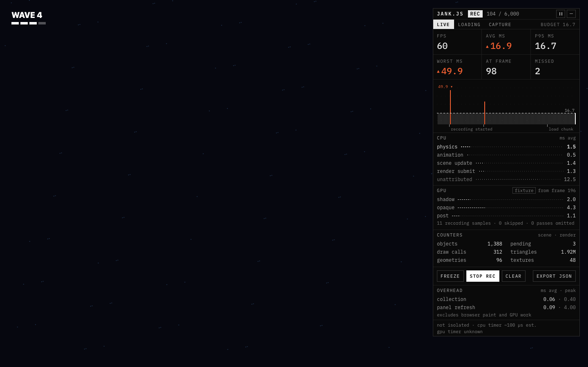
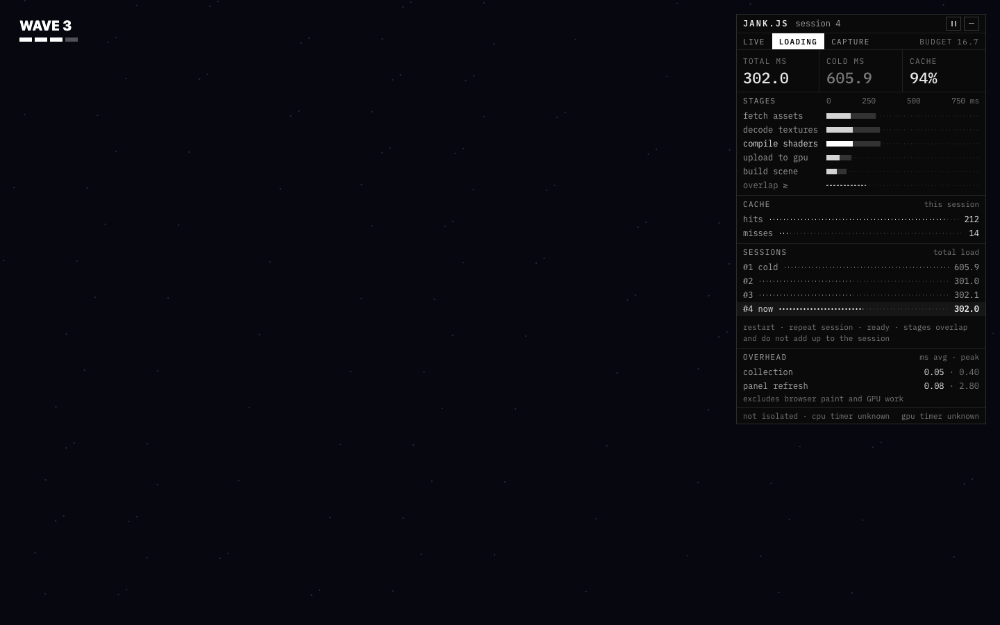
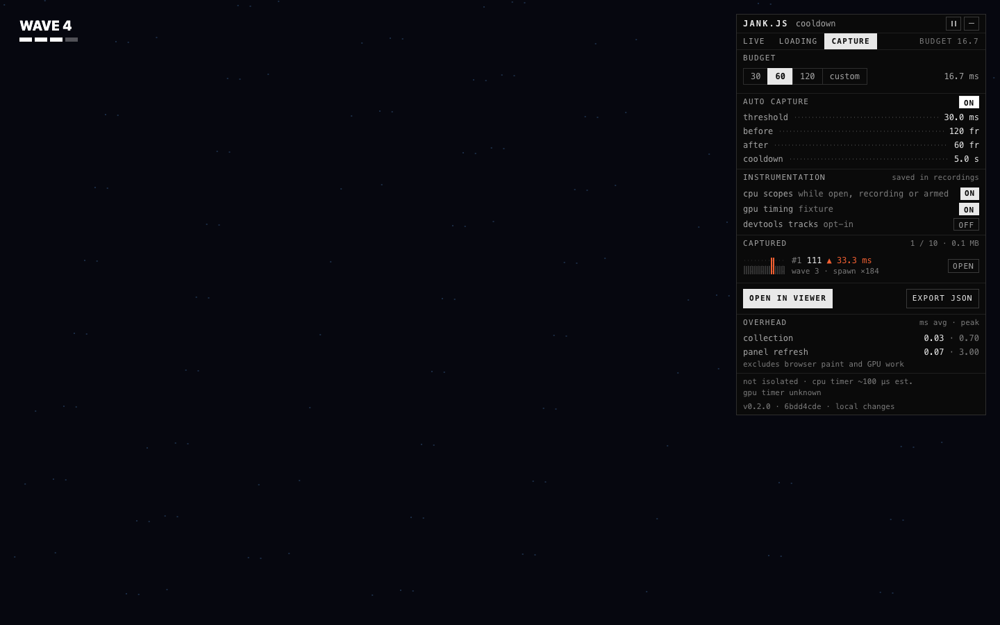
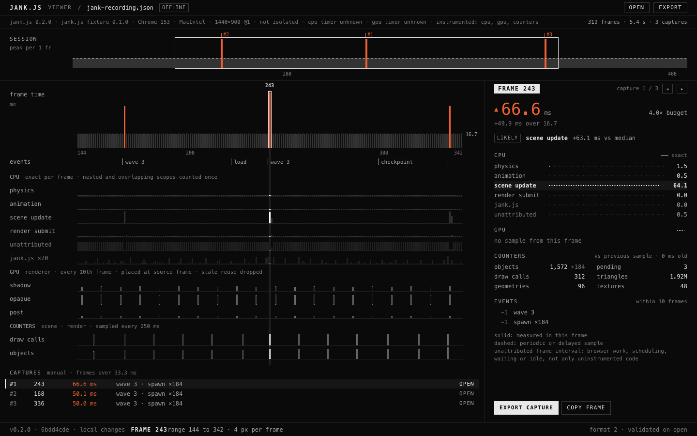

# jank.js user manual

jank.js helps developers and QA testers investigate uneven frames in browser games and interactive graphics. It runs inside the application, so the slowdown and the evidence are in the same place. Capture a slow frame, keep what happened around it, and open the recording offline. Measurements stay on your machine.

## 1. Quick start

1. Open an application that integrates jank.js. The panel sits in the top-right corner as one line.
2. Press **+** to open the full panel.
3. Leave the workload unchanged for a few seconds to see the normal frame pattern.
4. Press **REC**, then reproduce a slow operation in the application. Frames over budget appear orange in the graph.
5. Wait a few more frames, then press **STOP REC** and **EXPORT JSON**.
6. Open **OPEN RECORDING VIEWER.html** and choose the downloaded JSON file.

To add jank.js to your own application, see the [integration guide](integration.md).

## 2. The panel

Three sizes. Each one keeps recording.

| Size | What it shows                                                                                                         |
| ---- | --------------------------------------------------------------------------------------------------------------------- |
| LINE | One row: frame rate, average frame time and the worst frame so far.                                                   |
| MINI | A corner display for playtesting: fps, ms and p95, a rolling frame graph, the worst frame and the heaviest CPU scope. |
| FULL | Every readout, your systems and counters, and the LOADING and CAPTURE tabs.                                           |

**+** grows the panel and **−** shrinks it: LINE **+** opens FULL, FULL **−** drops to MINI, MINI **−** drops to LINE and MINI **+** returns to FULL. Inverse video means selected or on. The panel remembers the size you last chose for this site. The application chooses the corner.

The full panel has three tabs: **LIVE** (frame time, systems and counters), **LOADING** (how long the application took to get ready) and **CAPTURE** (budget, automatic capture and what has been captured). Move between tabs with the arrow keys, Home and End. The **BUDGET** readout beside the tabs is the current frame budget in milliseconds. **OVERHEAD** stays under every tab.

Keyboard users can reach every control with Tab. A **READ SUMMARY** button appears when focused in the full panel; it reads the current numbers once instead of announcing every update.

## 3. Reading the numbers

Orange means a frame missed the budget. Nothing else is orange, and an orange value always carries ▲ as well.

| Readout  | Meaning                                                                                         |
| -------- | ----------------------------------------------------------------------------------------------- |
| FPS      | Frames shown in the last second. It reads – until a full second has been measured.              |
| AVG MS   | Average frame interval across the history (the last 600 frames).                                |
| P95 MS   | 95 of every 100 frames in the history were this fast or faster.                                 |
| WORST MS | The slowest frame in the history. **AT FRAME** is its frame number.                             |
| MISSED   | Frames over budget in the history.                                                              |
| BUDGET   | 30, 60, 120 fps or your own target, in milliseconds per frame. Every graph and warning uses it. |

A frame counts as over budget when it is longer than the budget by more than two ticks of the browser's timer. Both ends of a frame interval are timer readings, so a smaller difference cannot be measured. Hover **MISSED** to see the exact limit.

The graph shows the most recent frames, newest on the right. The dashed line is the budget, labelled with its value. The worst frame in view carries its value and ▾. Ticks under the graph mark events from your application.

Solid bars and dotted leaders are measured in that frame. Dashed leaders are periodic or delayed samples, such as GPU timings.

## 4. Systems and counters

Name the work, count the things, mark the moments. The application registers systems and times them with scopes; see [integration](integration.md#systems-events-and-recording).

**CPU · ms avg** lists each named system's average time over the frames in the graph, in the order the application registered them. The heaviest one is bold. Scopes can nest and overlap; each millisecond is counted once. **unattributed** is time outside every scope: browser work, scheduling, waiting or idle time, not only code you have not wrapped yet. CPU scopes are collected while the panel is open (MINI or FULL), while recording or while automatic capture is armed.

**GPU** appears when the application supplies GPU timings. The chip names the source. GPU results arrive a few frames late, so the panel says which frame they belong to (**from frame 2,427**). A repeated result is dropped rather than shown as new.

**COUNTERS** shows values the application reports, such as objects, draw calls or triangles. They are counts, not durations or memory in bytes.

**VISIBILITY** and **TEMPORAL** appear only when the application integrates those sources.

### Loading

The **LOADING** tab measures how long the application took to get ready.

| Readout   | Meaning                                                                                                               |
| --------- | --------------------------------------------------------------------------------------------------------------------- |
| TOTAL     | This session's load time, in seconds (or milliseconds for short loads).                                               |
| COLD      | The first cold session's time: the ghost to beat.                                                                     |
| CACHE     | Cache hits as a share of hits and misses in this session.                                                             |
| STAGES    | Each stage's busy time on one shared axis. The longest stage is bright; the cold run's stage draws behind it in grey. |
| overlap ≥ | Stage time beyond the session's length: at least this much ran at the same time.                                      |
| SESSIONS  | Every retained session's total load time; **now** is the current one.                                                 |

Stages overlap, so their times do not add up to the session. These are elapsed CPU and waiting times, not GPU timings. A cold session starts with empty application caches; operating system and driver caches are not cleared.

## 5. Recording and capture

Catch the slow frame, keep what happened around it, send it.

| Control     | What it does                                                                                                                                                                  |
| ----------- | ----------------------------------------------------------------------------------------------------------------------------------------------------------------------------- |
| REC         | Records up to 6,000 frames with system samples and event markers. The header shows the count.                                                                                 |
| STOP REC    | Stops recording and keeps the recorded frames for export.                                                                                                                     |
| FREEZE      | Holds the display. The application and the recording carry on. The header shows **FROZEN**; **RESUME** returns to live numbers. The pause button in the header does the same. |
| CLEAR       | Clears frames, recordings, events, captures and system summaries. Export anything you need first.                                                                             |
| EXPORT JSON | Downloads the recording as versioned JSON, or the recent history when nothing has been recorded.                                                                              |

On the **CAPTURE** tab:

- **BUDGET** sets the frame budget: 30, 60 or 120 fps, or **custom** for your own target (1 to 1000 fps). It does not change the application's frame rate. 60 fps allows 16.7 ms per frame, 30 fps 33.3 ms and 120 fps 8.3 ms.
- **AUTO CAPTURE** keeps the frames around a slow frame. When a frame crosses the **threshold** (twice the budget unless you set one), jank.js keeps the frames **before** and **after** it, then waits out the **cooldown**, so one stall saves one capture. Click a value to type a new one; Enter keeps it and Escape puts it back.
- **INSTRUMENTATION** shows what recordings will contain: CPU scopes, GPU timing from the named source, and DevTools tracks, which are opt-in.
- **CAPTURED** lists up to ten captures from this page, newest last, each with its frame, its time and the nearest event. Captures are kept in memory until **CLEAR** or reload.
- **OPEN IN VIEWER** and each capture's **OPEN** hand the recording to the viewer in a new window, when the application has told the panel where its viewer is. Otherwise they are disabled; use **EXPORT JSON**.

Switching tabs or suspending a device can also produce a long interval; note what was happening when a spike occurred.

## 6. The viewer

One HTML file. Open it anywhere, drop a recording on it.

Open the hosted recording viewer or the downloaded **OPEN RECORDING VIEWER.html**, then press **OPEN** or drop a JSON recording onto the page. The viewer needs no running application, server or network connection; **OFFLINE** is a statement, not a mode. The panel's **OPEN IN VIEWER** hands a recording straight to a hosted viewer. The status bar confirms the format and that the file was validated on open. An invalid file is refused, and the recording already open stays.

- The line under the top bar is the recording's environment: versions, browser, platform, viewport and pixel ratio, isolation, timer precision and what was instrumented, then frames, length and captures.
- **SESSION** shows the whole recording as the peak frame per bucket. Orange is over budget; **#1**, **#2** mark captures. The white rectangle is the range shown below: drag it, or click elsewhere to move it there.
- The timeline shows that range at 4 px per frame: frame time with the budget line, events, one lane per CPU system (exact per frame), unattributed time, the tool's own cost (drawn ×20 so it is visible), GPU passes and two counters. GPU and counter lanes are dashed: GPU samples sit at the frame that produced them and a stale repeat is dropped; counters are periodic samples.
- Click a frame, or focus the timeline and use the arrow keys (Shift moves ten frames), Home and End for the ends of the range, and **[** and **]** to step through captures.
- **CAPTURES** lists frames over the capture threshold, longest first, with the nearest event. In an automatic capture this is the monitor's own rule; in a manual recording each spike counts once. **OPEN** moves the playhead there.
- The inspector shows the frame's time against the budget and **LIKELY**, a heuristic: the CPU scope furthest above its own median across the recording. Then the exact CPU scopes, the GPU sample from this frame if there is one, counters from the latest periodic sample with changes since the sample before, and events within 10 frames with their offsets.
- **EXPORT CAPTURE** saves the capture's before and after window as a new recording. **COPY FRAME** copies the frame as JSON. **EXPORT** saves the whole recording.

A section with no data says **not recorded**. Older version 1 recordings open as "format 1, migrated", with unavailable fields wherever the original file lacks the evidence. Keep the environment line in view when comparing recordings: browser, viewport, isolation and timer precision can differ between runs.

## 7. Accuracy and overhead

A profiler should show its own cost and say what it cannot see.

| Readout  | Meaning                                                                                                                                                                                                                                      |
| -------- | -------------------------------------------------------------------------------------------------------------------------------------------------------------------------------------------------------------------------------------------- |
| OVERHEAD | Collection and panel refresh, shown apart as average and peak milliseconds per frame. Browser paint and GPU work are not included. If panel refresh averages over 0.25 ms, the panel redraws four times a second instead of ten and says so. |
| Timers   | The footnote states isolation and the timer's observed precision. Browsers coarsen timers; cross-origin isolation allows finer ones but guarantees no particular resolution. Unknown means unknown.                                          |
| Recorded | Versions, browser, viewport, pixel ratio, isolation, instrumentation, and CPU and GPU timer precision, "unknown" where it is.                                                                                                                |
| GPU      | Only what your renderer supplies. The included WebGPU adapter reports the sum of render-pass durations for the pinned Three.js r186 renderer when the device exposes timestamp queries.                                                      |

System times are inclusive: a child scope can sit inside its parent. A parent taking 8 ms with a nested 4 ms child covers 8 ms together. Adding their displayed times would count some work twice.

**unknown** means the measurement was not captured. A truncated frame omitted some scopes because a limit was reached; its unattributed time includes the omitted instrumentation. Neither establishes that a system took zero time.

For browser tracing, turn on **devtools tracks** and follow the [DevTools steps](integration.md#devtools-scopes-and-markers). jank.js emits named scopes and markers; the browser's Performance panel provides the broader trace. Keep tracing settings the same when comparing runs, because instrumentation itself adds work.

See [measurement definitions](measurements.md) for the meanings of the optional loading, visibility and temporal measurements.

## Share a useful report

Attach the exported JSON and describe the action that caused the slowdown, the application version and whether the issue repeats. Include relevant workload or graphics settings and whether the tab was visible. The receiver can inspect the JSON with the standalone viewer.

Recordings contain environment details and application-provided labels and counters. Review those values for anything you do not want to share. jank.js downloads the file locally; sharing it is a separate action you control.

## Troubleshooting

| Problem                                     | What to check                                                                                                                                           |
| ------------------------------------------- | ------------------------------------------------------------------------------------------------------------------------------------------------------- |
| No CPU rows                                 | Open the panel (MINI or FULL) or record a short session; scopes are collected from then on. The application must register and time its systems.         |
| GPU timings are missing                     | Check the GPU status line and whether the application uses the supported renderer and device feature. CPU submission time is still measured separately. |
| A short recording is missing its last frame | A frame completes at the next boundary. Let a few frames run after the action before stopping.                                                          |
| Export exceeds the limit                    | Files are capped at 32 MiB. Try a shorter recording; developers can reduce scope capacity. The rejected export does not delete the recording.           |
| Import fails                                | Choose an original recording and read the error message. Invalid or unsupported files leave the previously loaded recording in place.                   |
| The panel seems unchanged                   | Check for **FROZEN** in the header. The panel redraws ten times a second (four in LINE) while frames continue to be collected.                          |
| OPEN IN VIEWER is disabled                  | The application has not given the panel its viewer's address. Use **EXPORT JSON** and open the file in the viewer.                                      |
| Two machines produce different results      | Compare workload, application version, settings, browser and recording environment before attributing the difference to one system.                     |

Recent history keeps 600 frames, and manual recording stops at 6,000 frames. Arming automatic capture in advance gives jank.js time to collect preceding frames with CPU scopes. See [limits](measurements.md#bounded-histories-and-files) for detailed capacities and [integration](integration.md) to add jank.js to your own application.
